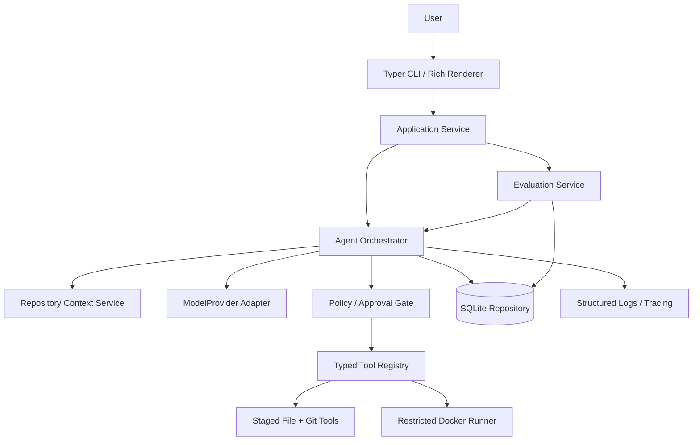
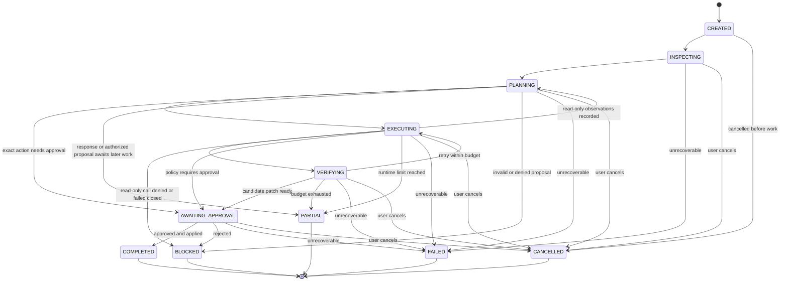
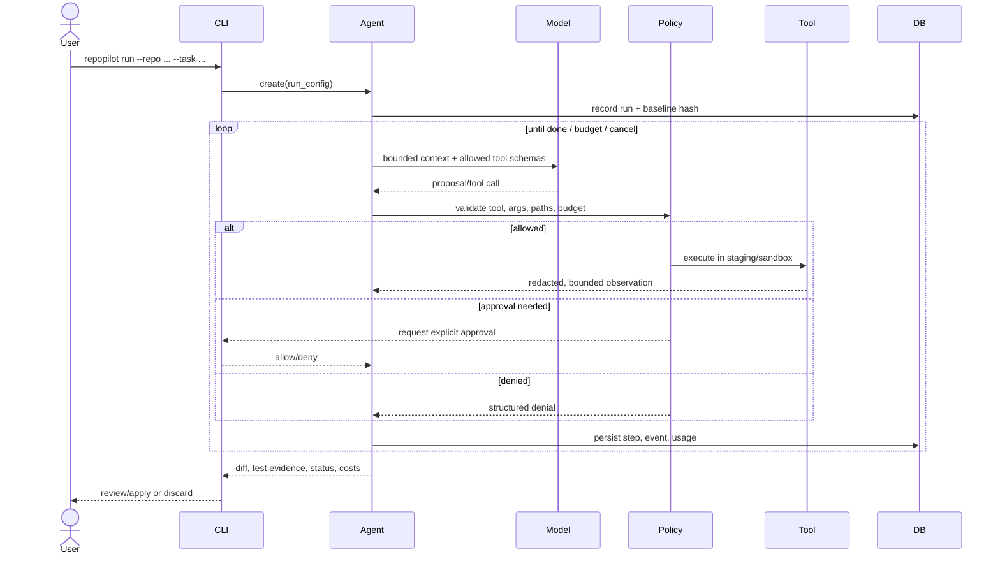

# RepoPilot — System Architecture and Technology Stack

> Status: Proposed v1.0 · 2026-11-13 · Reference deployment: local CLI + isolated Docker runner

## 1. Architectural principles
1. **Local-first:** no hosted application or authentication server in v1.
2. **Policy before execution:** the model proposes actions; trusted application code authorizes them.
3. **Separation of responsibilities:** CLI, agent, context, providers, tools, storage, and evaluation are independently testable.
4. **Verification over generation:** report the evidence for each patch, not just code output.
5. **Replayability:** preserve versioned config, model name, tool sequence and artifacts with secrets stripped.
6. **Small core:** build the orchestration loop without a heavyweight agent framework; adopt libraries for plumbing.

## 2. Full technology stack
| Area | Choice | Why | Stage |
|---|---|---|---|
| Runtime | Python >=3.12 | Strong typing ecosystem and developer familiarity | M0 |
| Project/package | `uv`, `pyproject.toml`, `uv.lock` | Fast reproducible installs | M0 |
| CLI / display | Typer, Rich | Typed CLI and readable terminal UX | M0 |
| Contracts | Pydantic v2 | Tool input and config validation | M1 |
| Environment config | pydantic-settings | Validate settings from env/config | M1 |
| Provider interface | Custom `ModelProvider` protocol | Avoid vendor coupling | M2 |
| HTTP client | httpx (only if adapter needs it) | Timeouts/retries and structured networking | M2 |
| Text search | `rg` binary + stdlib fallback | Efficient file/text discovery | M1 |
| Python code index | `ast` | Simple robust Python symbol extraction | M1 |
| General parsing | `tree-sitter`, `tree-sitter-python` | Extensible language symbol context | M4 optional |
| Git | Git CLI via safe argv | Predictable status/diff/patch operations | M1 |
| Isolation | Docker Engine, restricted container | Run untrusted code away from host | M3 |
| Persistence | SQLite, SQLAlchemy 2, Alembic | Local structured history and migrations | M2 |
| Tracing | OpenTelemetry API/SDK | Correlated tool and model spans | M4 |
| Logging | stdlib `logging` with JSON formatter | Machine-readable logs and redaction | M1 |
| Tests | pytest, pytest-cov | Unit/integration/security tests | M0 |
| Lint/format | Ruff | Consistent fast checks | M0 |
| Static types | mypy | Boundary correctness | M0 |
| Git hooks | pre-commit | Local automated checks | M0 |
| CI | GitHub Actions | Test matrix, lint, reports | M0 |

**Dependency rule:** target compatible, tested releases and lock exact resolved versions; do not assert unverified package versions in docs. `tree-sitter` becomes an optional dependency until needed.

## 3. Component diagram


## 4. Logical modules and responsibilities
- `cli`: argument parsing, interactive confirmations, user display; no direct filesystem mutation.
- `application`: use-case orchestration; creates run config, owns approval UX contract.
- `agent`: state machine, step budgets, and policy-gated orchestration; never bypasses policy. The
  existing `AgentOrchestrator` supports one model decision per run, validates and authorizes
  proposals, and records outcomes without dispatching tools. The opt-in
  `MultiStepAgentOrchestrator` supports bounded feedback cycles only through the fixed read-only
  dispatcher; it does not stage patches or claim verification.
- `providers`: model I/O normalization and provider error classification; bounded retries belong
  to the agent runtime. The OpenAI Responses adapter translates text and function-call history
  with correlated call IDs and rejects reasoning/continuation items the neutral response contract
  cannot represent.
- `context`: `RepositoryIntelligence` performs read-only bounded discovery, UTF-8 excerpts,
  literal search, Python AST indexing, and deterministic context selection over a manager-issued
  staged-workspace read capability. It does not call providers or grant tool execution.
- `tools`: explicit typed definitions, ordered registry, argument validation, and a separately
  callable allowlisted dispatcher for four read-only repository operations. Registry validation
  does not execute handlers or grant access; the dispatcher obtains a fresh policy decision and
  revalidates workspace/resource scope before execution. Only the opt-in multi-step orchestrator
  calls it; the single-decision orchestrator and CLI remain disconnected from tool execution.
- `security`: deterministic capability decisions, scoped path checks, exact-action approval request
  contracts, redaction, and sandbox restrictions. Policy results are decisions, not executable
  tokens; the future execution layer must revalidate paths and enforce the result.
- `sandbox`: copy-based repository workspace preparation, integrity checks, manager-owned bounded
  baseline snapshots, and descriptor-relative staged text replacement. Patch proposals are validated
  and freshly authorized before writes; individual replacements use same-directory atomic rename,
  while multi-file proposals are preflighted together but are not transactionally atomic. No source
  repository files are changed and no code is executed. Container lifecycle remains future work.
- `persistence`: transaction repositories and schema migrations.
- `evaluation`: task manifests, scoring, independent tests, aggregations.
- `observability`: audit events, logging, trace spans, usage accounting.
- `ui`: Rich console design tokens and components shared by CLI views.

## 5. Repository layout (target)
```text
repopilot/
├── AGENTS.md
├── PRD.md
├── ARCHITECTURE.md
├── DATABASE.md
├── DESIGN-SYSTEM.md
├── SECURITY.md
├── CODE-STYLE.md
├── TESTING.md
├── README.md
├── LICENSE
├── pyproject.toml
├── uv.lock
├── .env.example
├── .gitignore
├── .github/workflows/ci.yml
├── src/repopilot/
│   ├── __init__.py
│   ├── cli/{__init__.py,main.py,commands/}
│   ├── application/{__init__.py,services.py,patch_staging.py}
│   ├── agent/{__init__.py,loop.py,state.py,budget.py}
│   ├── providers/{__init__.py,base.py,mock.py,adapters/}
│   ├── context/{__init__.py,intelligence.py,discovery.py,reader.py,search.py,symbols.py,models.py}
│   ├── tools/{__init__.py,registry.py,read.py,patch.py,git.py,test.py}
│   ├── security/{__init__.py,policy.py,paths.py,redaction.py}
│   ├── sandbox/{__init__.py,execution.py,docker_backend.py,workspace.py,read_access.py,write_access.py,patches.py}
│   ├── persistence/{__init__.py,models.py,db.py,repositories/}
│   ├── evaluation/{__init__.py,runner.py,scoring.py,schemas.py}
│   ├── observability/{__init__.py,tracing.py,logging.py}
│   └── ui/{__init__.py,theme.py,renderers.py}
├── migrations/
├── tests/{unit,integration,security,e2e,fixtures}/
├── benchmarks/{README.md,suites/,fixtures/}
├── docs/{adr/,examples/}
└── scripts/
```
Folder names are intentional target architecture; files will be created incrementally, not left as empty placeholders.

## 6. Lifecycle / state machine

The result has a distinct `verified` boolean; `COMPLETED` alone is not proof of correctness.
Cancellation is allowed from `CREATED` and every active phase so a requested stop does not
require inventing progress. Unrecoverable processing failures may end any processing or
approval phase; failure to create a run does not produce a run record. These additions preserve
the terminal-state rule and leave verification retries subject to the execution budget.

The existing `AgentOrchestrator` makes at most one provider request. Text responses terminate as
`PARTIAL`; invalid or denied tool proposals terminate as `BLOCKED`; approval-required proposals
remain `AWAITING_APPROVAL`; and policy-allowed proposals terminate as `PARTIAL` because they
still await a future execution layer. An `ALLOW` is not execution, and this cycle creates neither
tool results nor verification evidence. The OpenAI adapter's unsupported reasoning continuation
remains rejected until the provider-neutral contract can preserve its continuation state.

Phase 4.7 adds a separate, explicitly invoked `MultiStepAgentOrchestrator`. It starts from a trusted
task, a caller-selected model, and a `ReadOnlyToolDispatcher` already bound to an active staging
workspace and matching run ID. It validates a complete response batch through the exact four-tool
registry before dispatch, then records only the dispatcher's correlated, bounded actual results.
Successful result messages retain call IDs and order and are explicitly marked as untrusted
repository data. Denial, approval requirement, malformed proposals, workspace failures, or
dispatcher errors stop the run; no failed or skipped call is described as executed. The additional
`EXECUTING → PLANNING` lifecycle edge represents another decision after successful read-only
observations. The existing single-decision API is unchanged.

Only the deterministic offline mock advertises both conversation continuation and repository
feedback support. Trusted `MultiStepConfig.allow_repository_feedback` must also be explicitly set;
it defaults to false. The OpenAI adapter explicitly advertises neither; a tool proposal can be
handled locally, but its result is never sent back to that provider, and no subsequent request is
made.
Every request, call proposal, run duration, feedback message, total conversation, and in-memory
event stream has a finite trusted ceiling. Runs end as `PARTIAL` for a text answer or a limit,
`BLOCKED` for an invalid/denied call, `AWAITING_APPROVAL` if the dispatcher reports that status,
or `FAILED` for provider/dispatcher failures. Read-only work
does not stage or apply changes, run Docker or shell commands, create independent verification
evidence, or mark a run complete.

Phase 4.8 adds `application.coding_task_demo` as a deterministic composition example, not a new
agent capability. It builds a synthetic repository inside a fresh temporary directory, runs the
existing multi-step orchestrator with two scripted mock responses and the real read-only dispatcher,
then selects a fixed fixture patch only after the expected read result and correlated feedback are
observed. It stages that correction through `PatchStager` under a separate modification capability,
checks the staged diff and source integrity, and reports static/fixture checks separately from
independent verification. Docker tests remain opt-in and require an operator-supplied digest-pinned
image and working rootless Docker environment; the default path does not invoke Docker. No changes
are applied to a live repository.

## 7. Execution sequence


## 8. Trust boundaries and workspace design
- **Host process:** CLI, DB, model API connections and policy. It must never execute model-generated shell commands directly on host.
- **Source repo:** considered untrusted, even when supplied by user; inspected read-only.
- **Staging:** a disposable copy/worktree; mutations occur here first.
- **Sandbox container:** executes bounded commands on staging, never receives provider credentials, SSH agent, host home mount, DB, or Docker socket.
- **Model provider:** external data recipient if cloud-hosted; send only relevant snippets and redact secrets where feasible.
- **Approvals:** from terminal user only; text inside repo cannot authorize actions.

The initial workspace manager (Phase 4, Step 4.1) makes a bounded copy into a random, private
temporary directory outside the selected source tree. It copies regular eligible files only,
excludes sensitive paths and generated directories, rejects symlinks and special files, and records
a sorted SHA-256 baseline without absolute paths or contents. Integrity reports compare the staged
tree with that baseline; they are not software correctness evidence. Linux descriptor-relative
operations with `O_NOFOLLOW` and `O_NOATIME` are required, so native Windows and macOS preparation
fail closed; use Linux or WSL2. No files are applied back to the source repository, and no code is
executed.

Phase 4.2 adds a manager-validated read capability over the active staged copy. Discovery is capped
at 20,000 entries, 2,000 returned files, and depth 20 by default. Reads are capped at 1 MB per file,
64 KB returned, and 400 lines. Literal search is capped at 500 files, 4 MB, and 500 matches.
Python indexing is capped at 500 files, 8 MB, and 50,000 AST nodes; selected context is capped at
64 KB. These are service defaults and can be lowered by callers. Every operation uses relative
paths and descriptor-relative no-follow reads; cleaned, forged, and foreign handles fail closed.
Staged content remains untrusted input. Sensitive-name exclusions and the workspace's embedded
secret-pattern scan are best-effort, not a guarantee that no secret reaches a future model. The AST
index is syntactic only and does not resolve imports, evaluate decorators/annotations, or execute
code. Descriptor checks reduce races but do not claim protection against every concurrent same-user
filesystem mutation. The four read-only schemas may be proposed to a provider, but
`AgentOrchestrator` does not dispatch them; the authorization boundary for directory-wide listing is
the fixed staged root; search and symbol indexing take explicit, per-file scopes. The dispatcher
caps outputs at 16 KB by default and does not send results to a provider. Limits are
defaults controlled by trusted application configuration; configured values must remain finite and
bounded. This read-only dispatch does not verify software correctness or transition an agent run to
completion.

Phase 4.4's proposal and result types live in `sandbox/patches.py`; its low-level manager-bound
writer lives in `sandbox/write_access.py`. `application/patch_staging.py` coordinates policy
authorization, preflight, staging, and diff previews without exposing a model-callable write tool.
It accepts complete UTF-8 replacements for existing baseline files only. Policy validation uses a
private schema inaccessible to providers; it does not connect to the agent loop or dispatcher.
Bounded unified diffs are previews against manager-retained baseline bytes, not evidence of applying
changes to a live repository.

Phase 4.6 adds security/approval.py for canonical, exact-action manifests and an instance-local
one-time receipt ledger. application/patch_approval.py validates the manager-owned staged patch,
rechecks source hashes using Linux descriptor-relative no-follow reads, reevaluates the live-write
policy, and requests confirmation through a trusted terminal adapter in ui/approval.py. Receipts
are retained by the application coordinator, are process-local, and are consumed once. Callers
receive the reviewed manifest and outcome, not the receipt. A digest binds manifest data but is not
evidence of consent.
The application service intentionally has no source writer: applying a patch consumes the receipt
and returns live_application_disabled. No CLI, agent, or dispatcher path can apply a live patch.

Phase 4.5 adds `sandbox/execution.py` and `sandbox/docker_backend.py` for policy-gated execution of
only the fixed Python syntax and pytest command families. `SandboxRunner` requires the exact active
manager-owned staging handle and `SANDBOXED_TEST_EXECUTION` authorization, checks staging integrity
before container creation and again before start, and returns a bounded structured result. The
Docker CLI backend accepts only a digest-pinned configured image, the local default Unix-socket
context, same-user rootless daemon, read-only staging, no network, a read-only root filesystem,
dropped capabilities, no-new-privileges, bounded tmpfs/resources, and fixed arguments. It never pulls images, mounts the
source tree, exposes credentials or the Docker socket to the container, or executes arbitrary
model-provided commands. The image must already contain Python and, for pytest, its dependencies.
Container path binding is pathname-based; manager revalidation reduces but cannot eliminate a
same-user replacement race between the final check and Docker Engine resolving the bind mount.
This runner is not exposed through the agent loop or CLI.

Detailed threat model: [SECURITY.md](SECURITY.md).

## 9. Core contracts
```python
from typing import Protocol
from repopilot.providers.base import ModelRequest, ModelResponse

class ModelProvider(Protocol):
    async def next_action(self, request: ModelRequest) -> ModelResponse: ...
```
`ModelResponse` is a tagged union of non-empty text and one-or-more proposed tool calls; a text
response represents zero calls. Provider-neutral contracts carry model identity, finish reason,
and optional usage. Provider failures expose stable retry classification. The mock adapter is
offline, deterministic, and rejects overlapping calls on one instance. A concrete adapter must
honor the request timeout and validate SDK output before constructing these values. A well-formed
tool call remains untrusted and requires a separate policy decision; the provider interface does
not authorize execution.

## 10. Budget and failure handling
`BudgetConfig` defaults to 30 model requests, 3 repair attempts, a 15-minute run, and 8 tool-call
proposals per response. The current orchestrator applies a stricter one-request ceiling. Its
monotonic deadline bounds the provider timeout and prevents a request from starting after expiry.
Proposal and repair counters are measured even when they cross their configured ceiling.

Provider token counts are accounted only after a response, when reported. Optional reported-token
ceilings stop processing that response if the known cumulative count is over the limit; they cannot
prevent one request from exceeding the ceiling. Missing or partial usage remains unknown for the
affected totals. No tokenizer estimate, provider price, or cost is fabricated. Hard pre-request
token/cost enforcement requires a future trusted estimate and provider-side limit. Command runtime
and output caps apply only when sandbox execution is implemented.

Orchestration events remain in memory, contain metadata only, and are bounded by event-count and
encoded-byte limits. A result reports how many events were dropped. No persistence or external
telemetry is performed by the current loop.

## 11. Data flow and privacy
- Input: user task + selected repository paths → filtered snippets → external model (unless locally hosted).
- Model output: typed proposal → policy validation → staged files or sandbox tool.
- Output: report + diff + redacted traces, stored locally.
- DB stores metadata and redacted excerpt fields, not the full workspace snapshot.
- Logs omit raw file contents by default.

## 12. Architecture decisions
| ADR | Decision | Reason | Revisit when |
|---|---|---|---|
| ADR-001 | Single agent before multi-agent | Easier testability and attribution | Measured baseline shows benefit |
| ADR-002 | CLI first | Focus on agent runtime | Core milestones M1-M4 achieved |
| ADR-003 | SQLite first | Local single-user performance | Remote concurrent use required |
| ADR-004 | Sandbox all generated command execution | Host safety | Never relax without review |
| ADR-005 | Provider abstraction | Model portability and offline tests | Adapter complexity demonstrably harmful |
| ADR-006 | No autonomous live patch apply | Human oversight | Explicit opt-in trusted mode added |

## 13. References
- [Typer](https://typer.tiangolo.com/)
- [Rich](https://rich.readthedocs.io/)
- [Tree-sitter](https://tree-sitter.github.io/tree-sitter/)
- [OpenTelemetry Python](https://opentelemetry.io/docs/languages/python/)
- [Docker rootless mode](https://docs.docker.com/engine/security/rootless/)
