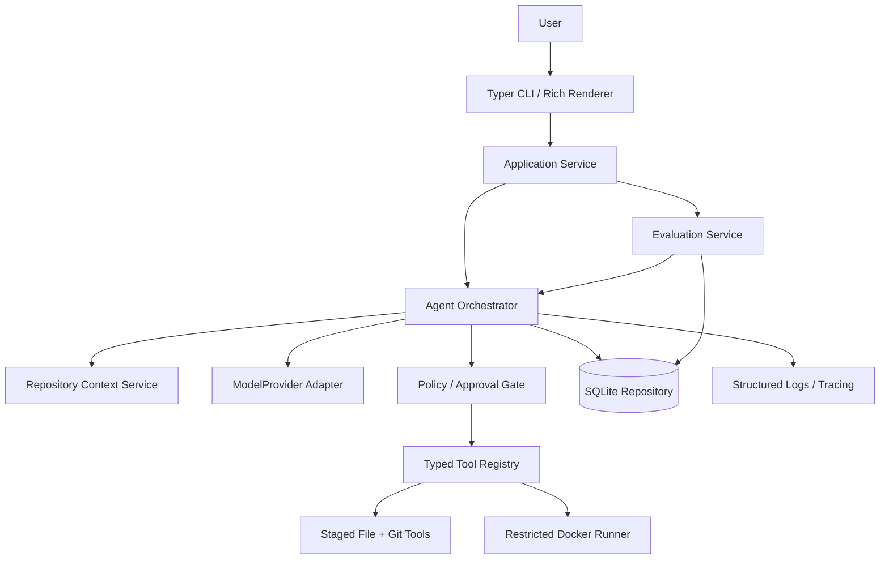
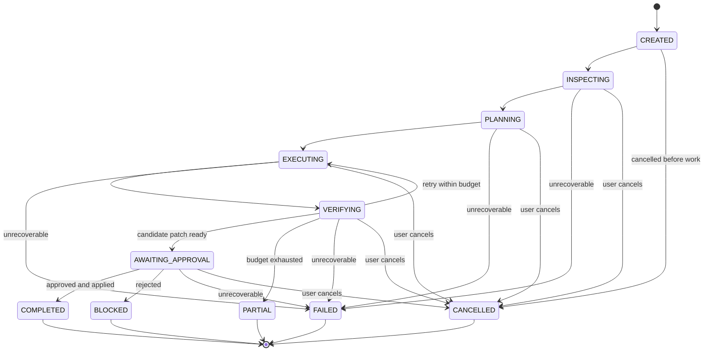
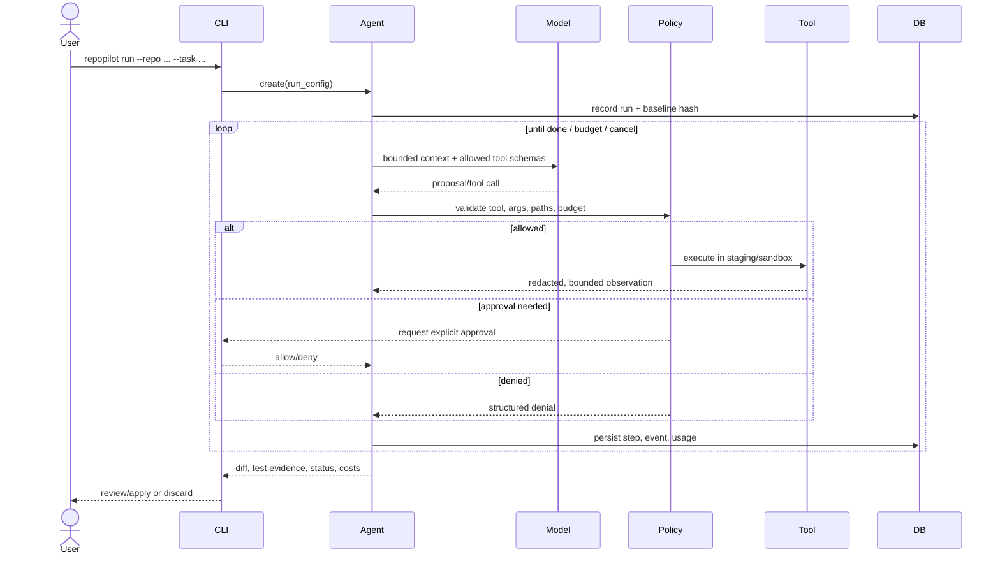

# RepoPilot — System Architecture and Technology Stack

> Status: Proposed v1.0 · 2026-11-13 · Reference deployment: local CLI + isolated Docker runner

## 1. Architectural principles
1. **Local-first:** no hosted application or authentication server in v1.
2. **Policy before execution:** the model proposes actions; trusted application code authorizes them.
3. **Separation of responsibilities:** CLI, agent, context, providers, tools, storage, and evaluation are independently testable.
4. **Verification over generation:** report the evidence for each patch, not just code output.
5. **Replayability:** preserve versioned config, model name, tool sequence and artifacts with secrets stripped.
6. **Small core:** build the orchestration loop without a heavyweight agent framework; adopt libraries for plumbing.

## 2. Full technology stack
| Area | Choice | Why | Stage |
|---|---|---|---|
| Runtime | Python >=3.12 | Strong typing ecosystem and developer familiarity | M0 |
| Project/package | `uv`, `pyproject.toml`, `uv.lock` | Fast reproducible installs | M0 |
| CLI / display | Typer, Rich | Typed CLI and readable terminal UX | M0 |
| Contracts | Pydantic v2 | Tool input and config validation | M1 |
| Environment config | pydantic-settings | Validate settings from env/config | M1 |
| Provider interface | Custom `ModelProvider` protocol | Avoid vendor coupling | M2 |
| HTTP client | httpx (only if adapter needs it) | Timeouts/retries and structured networking | M2 |
| Text search | `rg` binary + stdlib fallback | Efficient file/text discovery | M1 |
| Python code index | `ast` | Simple robust Python symbol extraction | M1 |
| General parsing | `tree-sitter`, `tree-sitter-python` | Extensible language symbol context | M4 optional |
| Git | Git CLI via safe argv | Predictable status/diff/patch operations | M1 |
| Isolation | Docker Engine, restricted container | Run untrusted code away from host | M3 |
| Persistence | SQLite, SQLAlchemy 2, Alembic | Local structured history and migrations | M2 |
| Tracing | OpenTelemetry API/SDK | Correlated tool and model spans | M4 |
| Logging | stdlib `logging` with JSON formatter | Machine-readable logs and redaction | M1 |
| Tests | pytest, pytest-cov | Unit/integration/security tests | M0 |
| Lint/format | Ruff | Consistent fast checks | M0 |
| Static types | mypy | Boundary correctness | M0 |
| Git hooks | pre-commit | Local automated checks | M0 |
| CI | GitHub Actions | Test matrix, lint, reports | M0 |

**Dependency rule:** target compatible, tested releases and lock exact resolved versions; do not assert unverified package versions in docs. `tree-sitter` becomes an optional dependency until needed.

## 3. Component diagram


## 4. Logical modules and responsibilities
- `cli`: argument parsing, interactive confirmations, user display; no direct filesystem mutation.
- `application`: use-case orchestration; creates run config, owns approval UX contract.
- `agent`: state machine, step budgets, retry policy, tool dispatch; never bypasses policy.
- `providers`: model I/O normalization and provider error classification; bounded retries belong
  to the agent runtime. The OpenAI Responses adapter translates text and function-call history
  with correlated call IDs and rejects reasoning/continuation items the neutral response contract
  cannot represent.
- `context`: file discovery, filtering, symbol index, bounded search, prompt assembly.
- `tools`: explicit typed definitions, ordered registry, and argument validation; validation is a
  contract boundary and does not execute handlers or grant access.
- `security`: path authorization, tool permissions, redaction, sandbox restrictions.
- `sandbox`: disposable checkout/worktree plus container lifecycle and quotas.
- `persistence`: transaction repositories and schema migrations.
- `evaluation`: task manifests, scoring, independent tests, aggregations.
- `observability`: audit events, logging, trace spans, usage accounting.
- `ui`: Rich console design tokens and components shared by CLI views.

## 5. Repository layout (target)
```text
repopilot/
├── AGENTS.md
├── PRD.md
├── ARCHITECTURE.md
├── DATABASE.md
├── DESIGN-SYSTEM.md
├── SECURITY.md
├── CODE-STYLE.md
├── TESTING.md
├── README.md
├── LICENSE
├── pyproject.toml
├── uv.lock
├── .env.example
├── .gitignore
├── .github/workflows/ci.yml
├── src/repopilot/
│   ├── __init__.py
│   ├── cli/{__init__.py,main.py,commands/}
│   ├── application/{__init__.py,services.py}
│   ├── agent/{__init__.py,loop.py,state.py,budget.py}
│   ├── providers/{__init__.py,base.py,mock.py,adapters/}
│   ├── context/{__init__.py,scanner.py,index.py,retrieval.py}
│   ├── tools/{__init__.py,registry.py,read.py,patch.py,git.py,test.py}
│   ├── security/{__init__.py,policy.py,paths.py,redaction.py}
│   ├── sandbox/{__init__.py,runner.py,workspace.py}
│   ├── persistence/{__init__.py,models.py,db.py,repositories/}
│   ├── evaluation/{__init__.py,runner.py,scoring.py,schemas.py}
│   ├── observability/{__init__.py,tracing.py,logging.py}
│   └── ui/{__init__.py,theme.py,renderers.py}
├── migrations/
├── tests/{unit,integration,security,e2e,fixtures}/
├── benchmarks/{README.md,suites/,fixtures/}
├── docs/{adr/,examples/}
└── scripts/
```
Folder names are intentional target architecture; files will be created incrementally, not left as empty placeholders.

## 6. Lifecycle / state machine

The result has a distinct `verified` boolean; `COMPLETED` alone is not proof of correctness.
Cancellation is allowed from `CREATED` and every active phase so a requested stop does not
require inventing progress. Unrecoverable processing failures may end any processing or
approval phase; failure to create a run does not produce a run record. These additions preserve
the terminal-state rule and leave verification retries subject to the execution budget.

## 7. Execution sequence


## 8. Trust boundaries and workspace design
- **Host process:** CLI, DB, model API connections and policy. It must never execute model-generated shell commands directly on host.
- **Source repo:** considered untrusted, even when supplied by user; inspected read-only.
- **Staging:** a disposable copy/worktree; mutations occur here first.
- **Sandbox container:** executes bounded commands on staging, never receives provider credentials, SSH agent, host home mount, DB, or Docker socket.
- **Model provider:** external data recipient if cloud-hosted; send only relevant snippets and redact secrets where feasible.
- **Approvals:** from terminal user only; text inside repo cannot authorize actions.

Detailed threat model: [SECURITY.md](SECURITY.md).

## 9. Core contracts
```python
from typing import Protocol
from repopilot.providers.base import ModelRequest, ModelResponse

class ModelProvider(Protocol):
    async def next_action(self, request: ModelRequest) -> ModelResponse: ...
```
`ModelResponse` is a tagged union of non-empty text and one-or-more proposed tool calls; a text
response represents zero calls. Provider-neutral contracts carry model identity, finish reason,
and optional usage. Provider failures expose stable retry classification. The mock adapter is
offline, deterministic, and rejects overlapping calls on one instance. A concrete adapter must
honor the request timeout and validate SDK output before constructing these values. A well-formed
tool call remains untrusted and requires a separate policy decision; the provider interface does
not authorize execution.

## 10. Budget and failure handling
Default proposed limits: max 30 model steps; max 3 repair attempts; max 15-minute wall clock; max 60-second individual command; max 1 MiB captured output per command (truncate sooner in prompts); configurable token and estimated USD caps. Users may lower limits; raising limits requires explicit configuration. Abort on invalid path, runaway tool call, sandbox failure, budget exhaustion, or cancellation.

## 11. Data flow and privacy
- Input: user task + selected repository paths → filtered snippets → external model (unless locally hosted).
- Model output: typed proposal → policy validation → staged files or sandbox tool.
- Output: report + diff + redacted traces, stored locally.
- DB stores metadata and redacted excerpt fields, not the full workspace snapshot.
- Logs omit raw file contents by default.

## 12. Architecture decisions
| ADR | Decision | Reason | Revisit when |
|---|---|---|---|
| ADR-001 | Single agent before multi-agent | Easier testability and attribution | Measured baseline shows benefit |
| ADR-002 | CLI first | Focus on agent runtime | Core milestones M1-M4 achieved |
| ADR-003 | SQLite first | Local single-user performance | Remote concurrent use required |
| ADR-004 | Sandbox all generated command execution | Host safety | Never relax without review |
| ADR-005 | Provider abstraction | Model portability and offline tests | Adapter complexity demonstrably harmful |
| ADR-006 | No autonomous live patch apply | Human oversight | Explicit opt-in trusted mode added |

## 13. References
- [Typer](https://typer.tiangolo.com/)
- [Rich](https://rich.readthedocs.io/)
- [Tree-sitter](https://tree-sitter.github.io/tree-sitter/)
- [OpenTelemetry Python](https://opentelemetry.io/docs/languages/python/)
- [Docker rootless mode](https://docs.docker.com/engine/security/rootless/)
