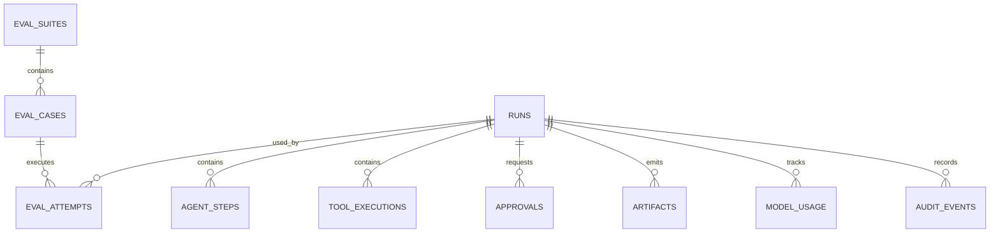

# RepoPilot — Data Architecture and Database Contract

> Status: Proposed v1.0 · Database: local SQLite; SQLAlchemy 2 ORM + Alembic migrations

## 1. Purpose and scope
Store run metadata, step execution, user approvals, model usage, artifact references, evaluation outcomes, and audit evidence. **Do not** store API keys, bearer tokens, raw private files, entire prompt histories, or sandbox filesystem contents. SQLite is a local, single-user persistence layer, not an identity service.

## 2. Database location and access
Default: platform-specific user data directory, e.g. `~/.local/share/repopilot/repopilot.db` on Linux; override with `REPOPILOT_DATA_DIR`. Use the relevant platform user-data location on Windows/macOS. Directory and DB permissions restricted to the invoking user where supported (directory 0700; file 0600). Do not put the runtime database inside a Git repository. Migrations are versioned.

**Access model:** only `persistence` repository classes open DB sessions. CLI calls application services; model providers, tool handlers and sandboxed code have **no DB access**. The sandbox cannot mount the data directory.

## 3. Entity relationship diagram


## 4. Tables and fields

### `runs`
| Column | Type | Notes |
|---|---|---|
| `id` | UUID string PK | Application-generated |
| `created_at`, `updated_at`, `finished_at` | ISO UTC timestamp | finished nullable |
| `status` | enum string | CREATED/INSPECTING/PLANNING/EXECUTING/VERIFYING/AWAITING_APPROVAL/COMPLETED/PARTIAL/BLOCKED/FAILED/CANCELLED |
| `task_summary` | text | User text, length-limited, redacted before persistence |
| `repo_path_hash` | text | Hash of canonical root; do not store absolute path by default |
| `git_base_commit` | text nullable | Git SHA or null |
| `provider_id`, `model_id` | text | No credentials |
| `config_json` | JSON text | Sanitized budgets, policy ID, sandbox image digest |
| `verified` | bool | False unless independent verification passed |
| `error_code`, `error_summary` | text nullable | Redacted |

### `agent_steps`
| Column | Type | Notes |
|---|---|---|
| `id` | UUID PK | |
| `run_id` | FK → runs | indexed |
| `sequence` | integer | unique within run |
| `kind` | enum | plan / model / tool / observation / retry / terminal |
| `started_at`, `finished_at` | UTC timestamp | |
| `status` | enum | started/success/failed/denied |
| `summary` | text | Redacted and bounded |
| `trace_id` | text nullable | Correlation only |

### `tool_executions`
| Column | Type | Notes |
|---|---|---|
| `id` | UUID PK | |
| `run_id`, `step_id` | FK | indexed |
| `tool_name` | text | From registry |
| `arguments_digest` | SHA-256 text | Hash canonicalized arguments; avoid raw args |
| `policy_decision` | enum | allow/deny/approval |
| `exit_code` | int nullable | Shell/test only |
| `duration_ms` | integer | |
| `result_summary` | text nullable | Sanitized, capped |
| `output_truncated` | bool | |

### `approvals`
| Column | Type | Notes |
|---|---|---|
| `id`, `run_id`, `tool_execution_id` | PK/FK | tool_execution_id nullable |
| `action_type` | enum | apply_patch / execute_sensitive_check / other |
| `request_summary` | text | Human-readable requested action |
| `decision` | enum | pending/approved/rejected/expired |
| `requested_at`, `decided_at` | UTC timestamp | |
| `approval_scope_hash` | text | Binds consent to exact proposed action + paths + args |

### `artifacts`
| Column | Type | Notes |
|---|---|---|
| `id`, `run_id` | PK/FK | |
| `kind` | enum | patch/report/test_log/eval_report |
| `relative_path` | text | Under controlled artifacts directory only |
| `sha256`, `size_bytes` | text/int | Integrity and size |
| `created_at` | UTC timestamp | |
| `sensitivity` | enum | public/local_sensitive |

### `model_usage`
| Column | Type | Notes |
|---|---|---|
| `id`, `run_id`, `step_id` | PK/FK | |
| `provider`, `model` | text | |
| `input_tokens`, `output_tokens` | int nullable | Unknown if provider omits |
| `estimated_cost_usd` | decimal nullable | Mark as estimated, pricing snapshot required |
| `latency_ms` | int | |
| `pricing_version` | text nullable | Basis of estimate |

Runtime currently accounts provider-reported token usage in memory only. Missing or partial
provider metadata remains unknown in the corresponding nullable fields. Any future estimated cost
must identify an injected trusted pricing source/version and must remain labeled as an estimate;
the current runtime does not calculate or persist costs.

### `eval_suites`
`id` PK, `name`, `version`, `manifest_hash`, `created_at`, `description`.

### `eval_cases`
`id` PK, `suite_id` FK, `case_key`, `fixture_commit`, `task_hash`, `test_manifest_hash`, `difficulty_tag`. Unique (`suite_id`, `case_key`). No private gold patch in model context.

### `eval_attempts`
`id` PK, `case_id` FK, `run_id` FK, `started_at`, `finished_at`, `passed` bool, `failure_category`, `tests_passed`, `tests_total`, `duration_ms`, `cost_usd_estimate`, `scorer_version`.

### `audit_events`
`id` PK, `run_id` FK nullable, `occurred_at`, `event_type`, `actor_type` (`user`/`system`/`agent`), `decision`, `details_digest`, `trace_id`. Append-only at application level; integrity check on export.

## 5. Cardinality / indexes
- `agent_steps(run_id, sequence)` UNIQUE; `runs(created_at)`, `runs(status)`.
- `tool_executions(run_id, step_id)`, `approvals(run_id, decision)`, `artifacts(run_id, kind)`.
- `eval_cases(suite_id, case_key)` UNIQUE; `eval_attempts(case_id, started_at)`.
- Foreign keys enabled with `PRAGMA foreign_keys=ON`; database journal `WAL` for local concurrency; transaction per state transition; retry on transient lock contention.

## 6. Writes and permissions
| Component | Run metadata | Tool results | Approvals | Evaluation | Secrets |
|---|---|---|---|---|---|
| CLI | through application only | no | submits decision via application | through application only | reads env/config in memory |
| Application/agent service | via repository classes | via repository classes | via repository classes | via service | never stores |
| Persistence layer | read/write | read/write | read/write | read/write | forbidden |
| Model adapter | no | no | no | no | provider token in memory only |
| Sandbox container | no | no | no | no | no access |
| Evaluator | via repository classes | read | no | via repository classes | no access |

## 7. State and transaction invariants
1. Every tool execution references one run, and step IDs must match its run.
2. Each state transition and audit event commit atomically.
3. An approval applies only to the exact action digest, scope, and run; changed args require reapproval.
4. An evaluation attempt is immutable after final score; reruns create new attempt rows.
5. `verified=true` only if configured independent verification checks have passed.
6. Terminal states have `finished_at` and cannot transition without creating a distinct resumed run.
7. Deleting a run must be explicit; prefer retention policy and cleanup command over implicit cascade deletion.

## 8. Retention, export, migration
- Default retain run metadata 30 days, artifacts 7 days; configurable `retention_days` and `artifact_retention_days`.
- `repopilot cleanup --dry-run` previews deletion; explicit `--apply` removes data.
- Export JSON/CSV with field-level redaction; warn about sensitive task summaries and diffs.
- Use Alembic versioned forward migrations; backup SQLite database before destructive migration; CI tests from blank and prior supported schema.
- Never log SQL bound values that contain repository content.

## 9. Example read queries (conceptual)
```sql
SELECT id, status, verified, created_at FROM runs ORDER BY created_at DESC LIMIT 20;
SELECT tool_name, policy_decision, duration_ms FROM tool_executions WHERE run_id = :run_id;
SELECT case_id, COUNT(*) AS attempts, SUM(CASE WHEN passed THEN 1 ELSE 0 END) AS passes
FROM eval_attempts GROUP BY case_id;
```

See [SECURITY.md](SECURITY.md) for data classification, [TESTING.md](TESTING.md) for migration checks.
